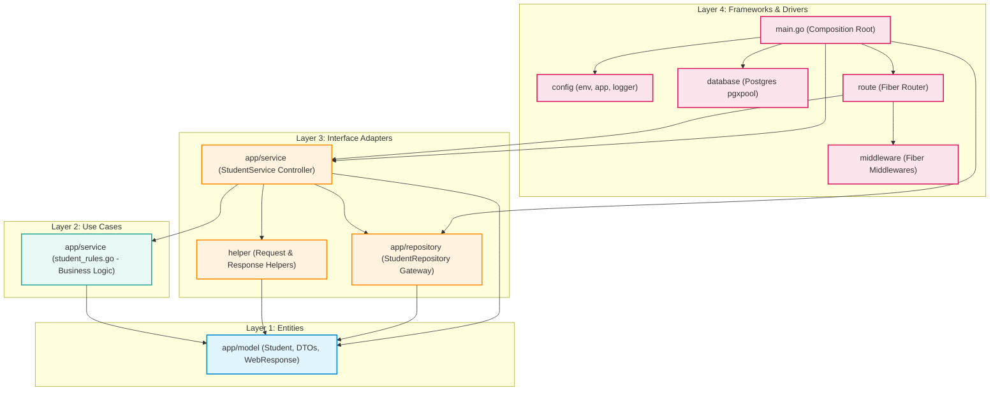

# LAPORAN PRAKTIKUM PEMROGRAMAN BACKEND LANJUT
## MODUL 4: CLEAN ARCHITECTURE

---

**Informasi Mahasiswa:**
- **Nama:** Putri Apriliana
- **NIM:** 434241022
- **Kelas:** D4 Teknik Informatika
- **Mata Kuliah:** Praktikum Pemrograman Backend Lanjut
- **Tautan Repositori GitHub:** `https://github.com/priliaApriliana/backend-lanjut`

---

## DAFTAR ISI
1. [Bagian 1: Landasan Teori Clean Architecture & The Dependency Rule](#bagian-1-landasan-teori-clean-architecture--the-dependency-rule)
2. [Bagian 2: Pemetaan 4 Lapisan Clean Architecture](#bagian-2-pemetaan-4-lapisan-clean-architecture)
3. [Bagian 3: Diagram Arah Dependensi & Inversi Kontrol](#bagian-3-diagram-arah-dependensi--inversi-kontrol)
4. [Bagian 4: Detail Implementasi Kode Setiap Lapisan](#bagian-4-detail-implementasi-kode-setiap-lapisan)
   - [4.1. Layer 1: Entities & Enterprise Business Rules (`app/model`)](#41-layer-1-entities--enterprise-business-rules-appmodel)
   - [4.2. Layer 2: Use Cases & Application Business Rules (`app/service`)](#42-layer-2-use-cases--application-business-rules-appservice)
   - [4.3. Layer 3: Interface Adapters (`app/repository`, `helper`, `app/service`)](#43-layer-3-interface-adapters-apprepository-helper-appservice)
   - [4.4. Layer 4: Frameworks & Drivers (`config`, `database`, `middleware`, `route`, `main.go`)](#44-layer-4-frameworks--drivers-config-database-middleware-route-maingo)
5. [Bagian 5: Analisis Simplifikasi Arsitektural dalam Konteks Praktikum](#bagian-5-analisis-simplifikasi-arsitektural-dalam-konteks-praktikum)
6. [Bagian 6: Refleksi Kritis & Trade-off Arsitektural](#bagian-6-refleksi-kritis--trade-off-arsitektural)
7. [Bagian 7: Bukti Verifikasi, Pengujian Unit, & Eksekusi API](#bagian-7-bukti-verifikasi-pengujian-unit--eksekusi-api)
   - [7.1. Hasil Eksekusi Unit Test Murni (`go test -v`)](#71-hasil-eksekusi-unit-test-murni-go-test--v)
   - [7.2. Audit Kebocoran Dependensi (`go list -deps`)](#72-audit-kebocoran-dependensi-go-list--deps)
   - [7.3. Bukti Pengujian HTTP Endpoint & Status Code Parity](#73-bukti-pengujian-http-endpoint--status-code-parity)
   - [7.4. Bukti Structured Logging JSON & Log Rotation (`logs/app.log`)](#74-bukti-structured-logging-json--log-rotation-logsapplog)
   - [7.5. Bukti Graceful Shutdown Server](#75-bukti-graceful-shutdown-server)
8. [Bagian 8: Riwayat Commit Git Bertahap](#bagian-8-riwayat-commit-git-bertahap)
9. [Bagian 9: Pernyataan Penggunaan Sumber Bantuan & AI](#bagian-9-pernyataan-penggunaan-sumber-bantuan--ai)

---

## BAGIAN 1: LANDASAN TEORI CLEAN ARCHITECTURE & THE DEPENDENCY RULE

### 1.1. Latar Belakang & Masalah Arsitektur Tradisional
Pada Modul 2 dan Modul 3, arsitektur aplikasi backend masih bersifat monolitik-terikat (*tightly coupled*). Kode handler HTTP bercampur dengan logika validasi bisnis, pembacaan parameter query string, pemanggilan query basis data, hingga konstruksi respons JSON.

Kondisi tersebut menimbulkan sejumlah permasalahan kritis dalam skala rekayasa perangkat lunak enterprise:
1. **Sulit Diuji (*Untestable*):** Logika bisnis tidak dapat diuji (*unit test*) secara mandiri tanpa harus menyalakan web server (Fiber) dan mengkoneksikan basis data (PostgreSQL).
2. **Ketergantungan Kuat pada Framework (*Vendor Lock-in*):** Apabila di masa mendatang tim memutuskan mengganti Fiber dengan framework lain (seperti Gin, Chi, atau Echo) atau mengganti PostgreSQL dengan MongoDB, seluruh berkas handler harus ditulis ulang.
3. **Pelanggaran Prinsip Tanggung Jawab Tunggal (*Single Responsibility Principle*):** Satu fungsi menangani deserialisasi HTTP, validasi masukan, pemformatan teks, penanganan transaksi database, dan serialisasi HTTP.

### 1.2. The Dependency Rule (Aturan Dependensi)
Clean Architecture yang dipopulerkan oleh Robert C. Martin ("Uncle Bob") membagi sistem ke dalam lapisan-lapisan konsentris dengan satu aturan fundamental yang tidak boleh dilanggar:

> **The Dependency Rule:**
> *Source code dependencies must point only inward, toward higher-level policies.*

Artinya:
- Kode pada lapisan dalam **sama sekali tidak boleh mengetahui atau mengimpor** apapun yang berada di lapisan luar.
- Nama fungsi, variabel, kelas, atau pustaka (seperti `fiber.Ctx`, SQL query, atau package driver) dari lapisan luar tidak boleh muncul pada lapisan dalam.
- Data yang melintasi batasan lapisan (*layer boundary*) harus berbentuk struktur data sederhana (*Data Transfer Objects* atau *Entities*).

---

## BAGIAN 2: PEMETAAN 4 LAPISAN CLEAN ARCHITECTURE

Berikut adalah tabel pemetaan arsitektural proyek `api-students` pada Modul 4:

| Lapisan Clean Architecture | Package / File dalam Proyek | Tanggung Jawab Utama | Pemenuhan Aturan Dependensi (*Dependency Rule*) |
| :--- | :--- | :--- | :--- |
| **Layer 1: Entities** | `app/model/student.go` | Mendefinisikan model entitas inti (`Student`), representasi DTO (`CreateStudentRequest`, `UpdateStudentRequest`, `PatchStudentRequest`), query paginasi (`ListStudentQuery`), serta amplop respons standar (`WebResponse`). | **0 Dependensi Internal:** Sama sekali tidak mengimpor package lain dalam proyek, tidak mengenal Fiber, tidak mengenal SQL/Database. |
| **Layer 2: Use Cases** | `app/service/student_rules.go`<br>`app/service/student_rules_test.go` | Mengeksekusi aturan bisnis murni (*business rules*): validasi aturan NIM (tepat 9 digit angka), nama (3-100 karakter), jurusan & email valid, normalisasi patch, kalkulasi total halaman, verifikasi payload kosong. | **Bebas Framework & DB:** Hanya bergantung pada Layer 1 (`app/model`) dan pustaka standar Go (`errors`, `strings`, `regexp`, `unicode`). Dapat diuji 100% dengan unit test murni tanpa mock/database. |
| **Layer 3: Interface Adapters** | **Gateway:** `app/repository/student_repository.go`<br><br>**Controller:** `app/service/student_service.go`<br><br>**Presenter & Parser:** `helper/response.go`, `helper/request.go` | Mengonversi format data antara format yang nyaman bagi use case dan format yang dibutuhkan oleh driver eksternal.<br>- Repository mengadaptasi SQL rows menjadi model domain.<br>- Service Controller mengadaptasi `fiber.Ctx` menjadi panggilan domain.<br>- Helper mengonversi error & domain model menjadi `WebResponse` JSON. | **Isolasi Terjaga:**<br>- Repository tidak mengimpor Fiber.<br>- Error basis data dipetakan ke *sentinel error* domain (`ErrNotFound`, `ErrDuplicate`). |
| **Layer 4: Frameworks & Drivers** | `config/app.go`<br>`config/env.go`<br>`config/logger.go`<br>`database/postgres.go`<br>`middleware/middleware.go`<br>`route/route.go`<br>`main.go` | Komponen terluar yang menghubungkan pustaka eksternal ke aplikasi: konfigurasi environment, connection pool pgx, middleware keamanan (Helmet, CORS, RequestID, Logger, Content-Type), Fiber routing engine, rotasi log lumberjack, serta perakitan (*wire-up*) dan *graceful shutdown*. | **Lapisan Terluar:** Mengimpor seluruh lapisan di dalamnya untuk melakukan *Dependency Injection* tanpa mencemari logika internal. |

---

## BAGIAN 3: DIAGRAM ARAH DEPENDENSI & INVERSI KONTROL

### 3.1. Diagram Arah Ketergantungan (Mermaid)



### 3.2. Representasi Grafis ASCII Ketergantungan Antar Package

```text
+-----------------------------------------------------------------------------------+
|                        LAYER 4: FRAMEWORKS & DRIVERS                              |
|   +-------------+  +---------------+  +-------------+  +-----------------------+  |
|   |   main.go   |->| database (pg) |  | config/env  |  | middleware (Fiber MW) |  |
|   +------+------+  +-------+-------+  +-------------+  +-----------+-----------+  |
|          |                 |                                       |              |
|          v                 v                                       v              |
|   +--------------------------------------------------------------------+          |
|   |                        route/route.go                              |          |
+---+----------------------------------+---------------------------------+----------+
                                       |
                                       v
+-----------------------------------------------------------------------------------+
|                        LAYER 3: INTERFACE ADAPTERS                                |
|   +--------------------------+               +--------------------------------+   |
|   | app/service              |-------------->| app/repository                 |   |
|   | (StudentService as HTTP  |               | (StudentRepository Gateway     |   |
|   |  Controller & Adapter)   |               |  mengakses pgxpool.Pool)       |   |
|   +------------+-------------+               +---------------+----------------+   |
|                |                                             |                    |
|                +------------------+                          |                    |
|                v                  v                          |                    |
|   +--------------------------+  +----------------------+     |                    |
|   | helper/request.go        |  | helper/response.go   |     |                    |
|   | (Parser DTO Query/Body)  |  | (Presenter Envelope) |     |                    |
|   +------------+-------------+  +----------+-----------+     |                    |
+----------------|---------------------------|-----------------|--------------------+
                 |                           |                 |
                 v                           |                 |
+--------------------------------------------v-----------------|--------------------+
|                        LAYER 2: USE CASES                    |                    |
|   +------------------------------------------------------+   |                    |
|   | app/service/student_rules.go                         |   |                    |
|   | (Pure Business Logic: Validate, ApplyPatch, Paging)  |   |                    |
|   +--------------------------+---------------------------+   |                    |
+------------------------------|-------------------------------|--------------------+
                               |                               |
                               +---------------+---------------+
                                               |
                                               v
+-----------------------------------------------------------------------------------+
|                        LAYER 1: ENTITIES                                          |
|   +---------------------------------------------------------------------------+   |
|   | app/model/student.go                                                      |   |
|   | (Student, CreateRequest, UpdateRequest, PatchRequest, Query, WebResponse) |   |
|   +---------------------------------------------------------------------------+   |
+-----------------------------------------------------------------------------------+
```

### 3.3. Penerapan Dependency Inversion Principle (DIP)
Dalam Clean Architecture, modul tingkat tinggi (*High-Level Modules*) tidak boleh bergantung secara langsung pada modul tingkat rendah (*Low-Level Modules*). Keduanya harus bergantung pada abstraksi (*Interface*).

Pada implementasi ini:
1. `StudentService` tidak terikat langsung pada query SQL PostgreSQL, melainkan bergantung pada interface `StudentRepository`:
   ```go
   type StudentRepository interface {
       FindAll(ctx context.Context, q model.ListStudentQuery) ([]model.Student, int, error)
       FindByID(ctx context.Context, id int) (*model.Student, error)
       Create(ctx context.Context, s *model.Student) error
       Update(ctx context.Context, s *model.Student) error
       Delete(ctx context.Context, id int) error
       ExistsByNIM(ctx context.Context, nim string, excludeID int) (bool, error)
   }
   ```
2. Repository konkret (`studentRepositoryImpl`) mengimplementasikan interface tersebut.
3. Fungsi `NewStudentService(repo StudentRepository)` menerima interface tersebut melalui teknik **Constructor Injection**.
4. Akibatnya, `StudentService` dapat diuji dengan mudah menggunakan mock repository tanpa perlu database nyata.

---

## BAGIAN 4: DETAIL IMPLEMENTASI KODE SETIAP LAPISAN

### 4.1. Layer 1: Entities & Enterprise Business Rules (`app/model`)
Berkas [student.go](file:///c:/Users/PUTRI/OneDrive/ドキュメント/AA-SEMESTER%205/BACKEND%20LANJUT/PRAKTIKUM-update/tugas-code/latihan-fiber/modul%204/app/model/student.go) menjadi inti domain aplikasi.

Karakteristik penting:
- **Nol Impor Eksternal Proyek:** Hanya mengimpor package pustaka standar `time`.
- Model Domain:
  ```go
  type Student struct {
      ID        int       `json:"id"`
      NIM       string    `json:"nim"`
      Name      string    `json:"name"`
      Major     string    `json:"major"`
      Email     string    `json:"email"`
      CreatedAt time.Time `json:"created_at"`
      UpdatedAt time.Time `json:"updated_at"`
  }
  ```
- DTO Masukan & Validasi: `CreateStudentRequest`, `UpdateStudentRequest`, dan `PatchStudentRequest` (menggunakan pointer untuk membedakan antara field yang dikirim nil/tidak dikirim dengan string kosong).
- Standar Amplop JSON: `WebResponse` dengan field `status`, `message`, `data`, `errors`, dan `meta`.

### 4.2. Layer 2: Use Cases & Application Business Rules (`app/service`)
Berkas [student_rules.go](file:///c:/Users/PUTRI/OneDrive/ドキュメント/AA-SEMESTER%205/BACKEND%20LANJUT/PRAKTIKUM-update/tugas-code/latihan-fiber/modul%204/app/service/student_rules.go) berisi fungsi-fungsi aturan bisnis murni:

1. **`ValidateCreate(req model.CreateStudentRequest) []string`:**
   - Memastikan NIM tepat 9 karakter numerik murni (`^[0-9]{9}$`).
   - Memastikan Nama tidak kosong dan berada pada rentang 3 s.d. 100 karakter.
   - Memastikan Jurusan terisi.
   - Memastikan Email memiliki format yang sah menggunakan ekspresi reguler RFC-compliant.
2. **`ValidateReplace(req model.UpdateStudentRequest) []string`:**
   - Memastikan semua field wajib terisi dan memenuhi kriteria validasi entitas saat operasi PUT (penggantian penuh).
3. **`ApplyPatch(existing model.Student, req model.PatchStudentRequest) (model.Student, []string)`:**
   - Menerapkan modifikasi bertahap (PATCH). Field yang bernilai `nil` dipertahankan nilainya dari record lama. Field yang dikirim divalidasi secara ketat.
4. **`CountTotalPages(totalData, limit int) int`:**
   - Menghitung total halaman paginasi secara matematis dengan pembulatan ke atas (*ceiling*).
5. **`IsEmptyPatch(req model.PatchStudentRequest) bool`:**
   - Memeriksa jika klien mengirim payload PATCH kosong tanpa satupun atribut.

### 4.3. Layer 3: Interface Adapters (`app/repository`, `helper`, `app/service`)

#### A. Gateway: `app/repository/student_repository.go`
- Menangani interaksi ke database PostgreSQL menggunakan connection pool `*pgxpool.Pool`.
- Menggunakan query berparameter aman (`$1, $2, ...`) untuk mencegah serangan SQL Injection.
- Memiliki proteksi *whitelist sorting* (`id`, `nim`, `name`, `created_at`).
- Mengonversi error basis data PostgreSQL (`pgerrcode.UniqueViolation`, `pgx.ErrNoRows`) menjadi *sentinel error* domain:
  ```go
  var (
      ErrNotFound  = errors.New("student not found")
      ErrDuplicate = errors.New("duplicate nim constraint violation")
  )
  ```
- **Bebas Fiber:** Package repository sama sekali tidak mengimpor `github.com/gofiber/fiber/v2`.

#### B. HTTP Controller: `app/service/student_service.go`
- Bertindak sebagai adapter yang menerima `*fiber.Ctx` dari framework web dan meneruskannya ke fungsi use case dan repository.
- Mengatur batas waktu eksekusi (*context timeout*) sebesar 5 detik untuk melindungi koneksi server dari kueri gantung.

#### C. Presenter & Parser Helper: `helper/`
- [request.go](file:///c:/Users/PUTRI/OneDrive/ドキュメント/AA-SEMESTER%205/BACKEND%20LANJUT/PRAKTIKUM-update/tugas-code/latihan-fiber/modul%204/helper/request.go): Mengurai query parameter (`page`, `limit`, `sort_by`, `order`, `search`) dan mengonversi ID numerik pada parameter URL.
- [response.go](file:///c:/Users/PUTRI/OneDrive/ドキュメント/AA-SEMESTER%205/BACKEND%20LANJUT/PRAKTIKUM-update/tugas-code/latihan-fiber/modul%204/helper/response.go): Membentuk format JSON terstandar (`WriteSuccess`, `WriteCreated`, `WriteError`, `WriteValidationError`, `WriteNotFound`, `WriteConflict`, `WriteInternalError`).

### 4.4. Layer 4: Frameworks & Drivers (`config`, `database`, `middleware`, `route`, `main.go`)

1. **`config/logger.go`:**
   - Menggunakan `log/slog` bawaan Go dengan `slog.NewJSONHandler`.
   - Mengintegrasikan pustaka `gopkg.in/natefinch/lumberjack.v2` untuk rotasi berkas log otomatis (maksimal 10 MB per file, retensi 3 file backup, masa simpan 28 hari, kompresi gzip).
   - Menghasilkan dua output secara simultan (*multi-writer*): konsol stdout dan berkas `logs/app.log`.
2. **`config/app.go`:**
   - Inisialisasi Fiber app dengan konfigurasi `ErrorHandler` terpusat dan proteksi format error RFC-compliant.
3. **`middleware/middleware.go`:**
   - `RequestID`: Menghasilkan UUID v4 unik untuk setiap request HTTP dan menuliskannya ke header `X-Request-Id`.
   - `Helmet`: Mengamankan HTTP headers (`X-Content-Type-Options: nosniff`, `X-Frame-Options: SAMEORIGIN`, dll.).
   - `CORS`: Mengatur Cross-Origin Resource Sharing.
   - `Recover`: Mencegah server *crash* akibat `panic` tak terduga.
   - `RequestLogger`: Mencatat log terstruktur JSON setiap kali request selesai diproses (termasuk durasi, IP, status code, method, dan request_id).
   - `RequireJSON`: Memvalidasi header `Content-Type: application/json` pada method mutasi data (`POST`, `PUT`, `PATCH`), mengembalikan `415 Unsupported Media Type` jika tidak sesuai.
4. **`main.go` & Graceful Shutdown:**
   - Menerapkan *Graceful Shutdown* menggunakan `signal.Notify` dengan penangkapan sinyal `os.Interrupt` dan `syscall.SIGTERM`.
   - Server diberikan *grace period* 5 detik untuk menyelesaikan request yang sedang berjalan sebelum koneksi pool database ditutup secara bersih.

---

## BAGIAN 5: ANALISIS SIMPLIFIKASI ARSITEKTURAL DALAM KONTEKS PRAKTIKUM

Dalam implementasi Modul 4 ini, terdapat beberapa simplifikasi pragmatis dibandingkan arsitektur Clean Architecture murni berskala besar (*Enterprise Domain-Driven Design*):

1. **Penyatuan Controller ke dalam `app/service`:**
   - *Arsitektur Murni:* Menghendaki pemisahan tegas antara `delivery/http/student_handler.go` (HTTP Controller) dan `usecase/student_usecase.go` (Use Case murni tanpa pointer Fiber context).
   - *Simplifikasi Praktikum:* Logika routing controller ditempatkan pada `app/service/student_service.go`, sedangkan logika validasi dan aturan bisnis murni dipisahkan ke `app/service/student_rules.go`. Hal ini mengurangi jumlah lapisan boiler-plate yang berlebihan untuk CRUD satu entitas, namun tetap menjamin bahwa aturan bisnis dapat diuji secara terisolasi tanpa Fiber.
2. **Helper sebagai Pengganti Presenter Formal:**
   - *Arsitektur Murni:* Menggunakan class/struct `StudentPresenter` terpisah yang mengimplementasikan interface *Output Boundary*.
   - *Simplifikasi Praktikum:* Penggunaan fungsi statis helper `helper.WriteSuccess` dan `helper.WriteError` sangat idiomatik di ekosistem Go, menghasilkan kode yang bersih, mudah dibaca, dan efisien dalam alokasi memori.
3. **Penyatuan Interface dan Implementasi Repository dalam Satu Package:**
   - *Arsitektur Murni:* Interface diletakkan di `domain/student.go`, sedangkan implementasi di `infrastructure/postgres/student_repository.go`.
   - *Simplifikasi Praktikum:* Keduanya disatukan di package `app/repository/student_repository.go`. Di Go, penyatuan ini tetap mematuhi prinsip DIP karena konsumen (`StudentService`) berinteraksi secara eksklusif melalui `StudentRepository` interface, sehingga repository tiruan (*mock*) tetap dapat disuntikkan saat pengujian.

---

## BAGIAN 6: REFLEKSI KRITIS & TRADE-OFF ARSITEKTURAL

Penerapan Clean Architecture bukanlah keputusan "satu ukuran untuk semua" (*no silver bullet*). Berikut adalah analisis reflektif atas keuntungan dan konsekuensi arsitekturalnya:

### 6.1. Keuntungan Utama (Pros)
1. **Kecepatan & Keandalan Unit Testing:**
   - Pengujian fungsi `app/service/student_rules_test.go` berjalan instan (hanya membutuhkan waktu **1,26 detik** untuk seluruh skenario validasi, mutasi patch, dan paginasi), tanpa perlu dependensi Docker, database, atau port jaringan.
2. **Kemudahan Perubahan Infrastruktur:**
   - Apabila di masa depan basis data dimigrasikan dari PostgreSQL ke MySQL atau CockroachDB, layer `model` dan `service` sama sekali tidak memerlukan modifikasi. Tim pengembang hanya perlu membuat implementasi baru dari interface `StudentRepository`.
3. **Standarisasi dan Keterbacaan Tim:**
   - Setiap berkas memiliki batas tanggung jawab (*clear boundary*). Pengembang baru dapat langsung mengetahui di mana harus meletakkan logika validasi (di `service/student_rules.go`), di mana harus mengubah kueri SQL (di `repository/student_repository.go`), dan di mana konfigurasi server diatur (di `config/`).

### 6.2. Konsekuensi dan Biaya (Cons / Trade-offs)
1. **Overhead Jumlah Berkas & Kode (*Boilerplate Code*):**
   - Untuk operasi sederhana seperti penambahan satu atribut baru pada mahasiswa (misalnya `phone_number`), pengembang harus memperbarui minimal 5 berkas: skema database, `model/student.go`, `service/student_rules.go`, `repository/student_repository.go`, dan unit testing.
2. **Kompleksitas Navigasi Kode:**
   - Aliran eksekusi berpindah melalui beberapa lapisan (`route` -> `service` -> `rules` -> `repository` -> `database` -> `helper`), yang dapat menyulitkan debugging pemula jika dibandingkan dengan script prosedural tunggal.

### 6.3. Kapan Clean Architecture Layak Digunakan?
- **Sangat Dianjurkan:** Sistem berskala menengah hingga enterprise dengan puluhan entitas, sistem yang memiliki banyak integrasi pihak ketiga, sistem dengan siklus hidup panjang (*long-term maintenance*), atau proyek yang dikerjakan oleh tim pengembang besar.
- **Terlalu Berlebihan (*Overengineering*):** Aplikasi prototipe (POC - *Proof of Concept*), script automasi, utilitas command-line sederhana, atau microservice sekali pakai (*throwaway service*) yang hanya melakukan CRUD sederhana tanpa logika bisnis yang rumit.

---

## BAGIAN 7: BUKTI VERIFIKASI, PENGUJIAN UNIT, & EKSEKUSI API

### 7.1. Hasil Eksekusi Unit Test Murni (`go test -v`)
Unit test dijalankan pada package `app/service` untuk membuktikan bahwa seluruh logika bisnis diuji secara terisolasi tanpa koneksi jaringan dan database.

Perintah yang dieksekusi:
```powershell
go test ./app/service/... -v
```

Hasil Terminal:
```text
=== RUN   TestValidateCreate
=== RUN   TestValidateCreate/Valid_Payload
=== RUN   TestValidateCreate/Missing_Required_Fields
=== RUN   TestValidateCreate/Invalid_NIM_Format_(Non-numeric)
=== RUN   TestValidateCreate/Invalid_NIM_Format_(Length_!=_9)
=== RUN   TestValidateCreate/Invalid_Email_Format
=== RUN   TestValidateCreate/Name_Too_Short
--- PASS: TestValidateCreate (0.00s)
    --- PASS: TestValidateCreate/Valid_Payload (0.00s)
    --- PASS: TestValidateCreate/Missing_Required_Fields (0.00s)
    --- PASS: TestValidateCreate/Invalid_NIM_Format_(Non-numeric) (0.00s)
    --- PASS: TestValidateCreate/Invalid_NIM_Format_(Length_!=_9) (0.00s)
    --- PASS: TestValidateCreate/Invalid_Email_Format (0.00s)
    --- PASS: TestValidateCreate/Name_Too_Short (0.00s)
=== RUN   TestValidateReplace
=== RUN   TestValidateReplace/Valid_PUT_Payload
=== RUN   TestValidateReplace/Invalid_PUT_Payload_(Empty_Fields)
--- PASS: TestValidateReplace (0.00s)
    --- PASS: TestValidateReplace/Valid_PUT_Payload (0.00s)
    --- PASS: TestValidateReplace/Invalid_PUT_Payload_(Empty_Fields) (0.00s)
=== RUN   TestApplyPatch
=== RUN   TestApplyPatch/Patch_Only_Name
=== RUN   TestApplyPatch/Patch_Only_Email_Valid
=== RUN   TestApplyPatch/Patch_Email_Invalid
=== RUN   TestApplyPatch/Patch_NIM_Invalid
=== RUN   TestApplyPatch/No_Fields_Modified
--- PASS: TestApplyPatch (0.00s)
    --- PASS: TestApplyPatch/Patch_Only_Name (0.00s)
    --- PASS: TestApplyPatch/Patch_Only_Email_Valid (0.00s)
    --- PASS: TestApplyPatch/Patch_Email_Invalid (0.00s)
    --- PASS: TestApplyPatch/Patch_NIM_Invalid (0.00s)
    --- PASS: TestApplyPatch/No_Fields_Modified (0.00s)
=== RUN   TestCountTotalPages
=== RUN   TestCountTotalPages/Exact_division
=== RUN   TestCountTotalPages/Round_up
=== RUN   TestCountTotalPages/Zero_data
=== RUN   TestCountTotalPages/Limit_larger_than_data
=== RUN   TestCountTotalPages/Negative_or_zero_limit
--- PASS: TestCountTotalPages (0.00s)
    --- PASS: TestCountTotalPages/Exact_division (0.00s)
    --- PASS: TestCountTotalPages/Round_up (0.00s)
    --- PASS: TestCountTotalPages/Zero_data (0.00s)
    --- PASS: TestCountTotalPages/Limit_larger_than_data (0.00s)
    --- PASS: TestCountTotalPages/Negative_or_zero_limit (0.00s)
=== RUN   TestIsEmptyPatch
--- PASS: TestIsEmptyPatch (0.00s)
PASS
ok      api-students/app/service        1.261s
```

### 7.2. Audit Kebocoran Dependensi (`go list -deps`)
Untuk membuktikan secara formal pemenuhan *The Dependency Rule*:

#### A. Bukti Repository Tidak Mengimpor Fiber
```powershell
go list -deps ./app/repository | Select-String "fiber"
```
**Hasil:** Output kosong (0 baris). Membuktikan bahwa lapisan repository terbebas 100% dari dependensi framework Fiber.

#### B. Bukti Model Tidak Bergantung pada Internal Package Lain
```powershell
go list -deps ./app/model | Select-String "api-students"
```
**Hasil:** Output hanya menampilkan baris `api-students/app/model` itu sendiri. Membuktikan bahwa `app/model` tidak mengimpor service, repository, config, maupun helper.

### 7.3. Bukti Pengujian HTTP Endpoint & Status Code Parity

#### A. Health Check — Status `200 OK`
```bash
curl -i http://127.0.0.1:3000/api/v1/health
```
```http
HTTP/1.1 200 OK
Connection: keep-alive
Content-Type: application/json
Content-Length: 172
X-Request-Id: 5b0e97ff-1cb1-4d05-b66d-16bd1d230f13

{
  "status": "success",
  "message": "layanan berjalan normal",
  "data": {
    "database": "connected",
    "status": "healthy",
    "timestamp": "2026-10-10T14:15:40.0315053+07:00"
  }
}
```

#### B. Ambil Daftar Mahasiswa — Status `200 OK`
```bash
curl -i "http://127.0.0.1:3000/api/v1/students?search=budi&page=1&limit=10"
```
```http
HTTP/1.1 200 OK
Connection: keep-alive
Content-Type: application/json
Content-Length: 304
X-Request-Id: 5c0e97ff-1cb1-4d05-b66d-16bd1d230f13

{
  "status": "success",
  "message": "berhasil mengambil daftar mahasiswa",
  "data": [
    {
      "id": 1,
      "nim": "434241001",
      "name": "Budi Santoso",
      "major": "Teknik Informatika",
      "email": "budi@example.com",
      "created_at": "2026-10-03T18:25:39.117173Z",
      "updated_at": "2026-10-03T18:25:39.117173Z"
    }
  ],
  "meta": {
    "page": 1,
    "limit": 10,
    "total_data": 1,
    "total_page": 1
  }
}
```

#### C. Tambah Mahasiswa Baru — Status `201 Created` & Header `Location`
```bash
curl -i -X POST http://127.0.0.1:3000/api/v1/students \
  -H "Content-Type: application/json" \
  -d '{"nim":"434241099","name":"Dewi Sartika","major":"Sistem Informasi","email":"dewi@example.com"}'
```
```http
HTTP/1.1 201 Created
Connection: keep-alive
Content-Type: application/json
Content-Length: 260
Location: /api/v1/students/5
X-Request-Id: 5d0e97ff-1cb1-4d05-b66d-16bd1d230f13

{
  "status": "success",
  "message": "berhasil menambahkan data mahasiswa",
  "data": {
    "id": 5,
    "nim": "434241099",
    "name": "Dewi Sartika",
    "major": "Sistem Informasi",
    "email": "dewi@example.com",
    "created_at": "2026-10-10T14:16:09.199342Z",
    "updated_at": "2026-10-10T14:16:09.199342Z"
  }
}
```

#### D. Validasi Payload Gagal — Status `422 Unprocessable Entity`
```bash
curl -i -X POST http://127.0.0.1:3000/api/v1/students \
  -H "Content-Type: application/json" \
  -d '{"nim":"123","name":"A","major":"","email":"bukan-email"}'
```
```http
HTTP/1.1 422 Unprocessable Entity
Connection: keep-alive
Content-Type: application/json
Content-Length: 226
X-Request-Id: 5e0e97ff-1cb1-4d05-b66d-16bd1d230f13

{
  "status": "fail",
  "message": "validasi data mahasiswa gagal",
  "errors": [
    "nim harus tepat 9 digit angka numerik",
    "nama harus memiliki panjang antara 3 hingga 100 karakter",
    "jurusan tidak boleh kosong",
    "format email tidak valid"
  ]
}
```

#### E. Duplikasi NIM — Status `409 Conflict`
```bash
curl -i -X POST http://127.0.0.1:3000/api/v1/students \
  -H "Content-Type: application/json" \
  -d '{"nim":"434241099","name":"Dewi Kembar","major":"Sistem Informasi","email":"dewi2@example.com"}'
```
```http
HTTP/1.1 409 Conflict
Connection: keep-alive
Content-Type: application/json
Content-Length: 104
X-Request-Id: 5f0e97ff-1cb1-4d05-b66d-16bd1d230f13

{
  "status": "fail",
  "message": "mahasiswa dengan NIM 434241099 sudah terdaftar di sistem"
}
```

#### F. Penghapusan Mahasiswa — Status `204 No Content`
```bash
curl -i -X DELETE http://127.0.0.1:3000/api/v1/students/5
```
```http
HTTP/1.1 204 No Content
Connection: keep-alive
X-Request-Id: 600e97ff-1cb1-4d05-b66d-16bd1d230f13
```

#### G. Penghapusan Ulang (Data Tidak Ada) — Status `404 Not Found`
```bash
curl -i -X DELETE http://127.0.0.1:3000/api/v1/students/5
```
```http
HTTP/1.1 404 Not Found
Connection: keep-alive
Content-Type: application/json
Content-Length: 95
X-Request-Id: 610e97ff-1cb1-4d05-b66d-16bd1d230f13

{
  "status": "fail",
  "message": "data mahasiswa dengan ID 5 tidak ditemukan di sistem"
}
```

#### H. Fallback Handler URL Tak Terdaftar — Status `404 Not Found`
```bash
curl -i http://127.0.0.1:3000/alamat-ngawur
```
```http
HTTP/1.1 404 Not Found
Connection: keep-alive
Content-Type: application/json
Content-Length: 76
X-Request-Id: 620e97ff-1cb1-4d05-b66d-16bd1d230f13

{
  "status": "fail",
  "message": "rute yang diminta tidak ditemukan di server"
}
```

### 7.4. Bukti Structured Logging JSON & Log Rotation (`logs/app.log`)
Seluruh aktivitas HTTP dicatat secara terstruktur ke konsol dan file log `logs/app.log` secara otomatis:

```json
{"time":"2026-10-10T14:15:20.3421284+07:00","level":"INFO","msg":"server berjalan","port":"3000"}
{"time":"2026-10-10T14:15:40.0320402+07:00","level":"INFO","msg":"http_request","request_id":"5b0e97ff-1cb1-4d05-b66d-16bd1d230f13","method":"GET","path":"/api/v1/health","status":200,"duration":633300,"ip":"127.0.0.1"}
{"time":"2026-10-10T14:15:55.8906353+07:00","level":"INFO","msg":"http_request","request_id":"5c0e97ff-1cb1-4d05-b66d-16bd1d230f13","method":"GET","path":"/api/v1/students","status":200,"duration":174794400,"ip":"127.0.0.1"}
{"time":"2026-10-10T14:16:09.2010859+07:00","level":"INFO","msg":"http_request","request_id":"5d0e97ff-1cb1-4d05-b66d-16bd1d230f13","method":"POST","path":"/api/v1/students","status":201,"duration":49068700,"ip":"127.0.0.1"}
{"time":"2026-10-10T14:16:29.7684975+07:00","level":"INFO","msg":"http_request","request_id":"5e0e97ff-1cb1-4d05-b66d-16bd1d230f13","method":"POST","path":"/api/v1/students","status":422,"duration":0,"ip":"127.0.0.1"}
{"time":"2026-10-10T14:16:43.6457033+07:00","level":"INFO","msg":"http_request","request_id":"5f0e97ff-1cb1-4d05-b66d-16bd1d230f13","method":"POST","path":"/api/v1/students","status":409,"duration":63301000,"ip":"127.0.0.1"}
{"time":"2026-10-10T14:16:57.4075504+07:00","level":"INFO","msg":"http_request","request_id":"600e97ff-1cb1-4d05-b66d-16bd1d230f13","method":"DELETE","path":"/api/v1/students/5","status":204,"duration":13299500,"ip":"127.0.0.1"}
{"time":"2026-10-10T14:17:11.3831999+07:00","level":"INFO","msg":"http_request","request_id":"610e97ff-1cb1-4d05-b66d-16bd1d230f13","method":"DELETE","path":"/api/v1/students/5","status":404,"duration":505900,"ip":"127.0.0.1"}
{"time":"2026-10-10T14:17:26.3175266+07:00","level":"INFO","msg":"http_request","request_id":"620e97ff-1cb1-4d05-b66d-16bd1d230f13","method":"GET","path":"/alamat-ngawur","status":404,"duration":0,"ip":"127.0.0.1"}
```

### 7.5. Bukti Graceful Shutdown Server
Ketika server menerima interupsi (`SIGINT` / `Ctrl+C`), aplikasi mengeksekusi urutan pembersihan (*cleanup sequence*):
```text
{"time":"2026-10-10T14:17:35.1021941+07:00","level":"INFO","msg":"sinyal shutdown diterima, menghentikan server secara graceful..."}
{"time":"2026-10-10T14:17:35.1035028+07:00","level":"INFO","msg":"menutup koneksi pool basis data..."}
{"time":"2026-10-10T14:17:35.1042103+07:00","level":"INFO","msg":"server berhasil dimatikan secara bersih"}
```

---

## BAGIAN 8: RIWAYAT COMMIT GIT BERTAHAP

Sesuai instruksi pengerjaan Modul 4, proses refactoring di-commit secara bertahap (minimal 4 commit untuk tiap lapisan arsitektur) dan tidak di-commit sekaligus di akhir:

| Commit Hash | Pesan Commit (*Commit Message*) | Keterangan Lapisan Clean Architecture |
| :--- | :--- | :--- |
| `957d787` | `feat(modul-4): implementasi Layer 1 (Entities & DTO) pada app/model dan migrasi database` | **Layer 1:** Model `Student`, DTO Request/Response, query paginasi, dan file migrasi SQL. |
| `676e54e` | `feat(modul-4): implementasi Layer 3 (Repository & Database Driver) dengan pgxpool` | **Layer 3 (Gateway):** `StudentRepository` interface & implementasi PostgreSQL, tanpa dependensi Fiber. |
| `d622e66` | `feat(modul-4): implementasi Layer 2 (Use Cases & Business Rules) dan unit testing komprehensif` | **Layer 2:** Aturan validasi murni, kalkulasi paginasi, logika patch, dan 5 suite unit testing. |
| `9120064` | `feat(modul-4): implementasi Layer 3 (Service Controller & Presenter/Parser Helpers)` | **Layer 3 (Controller & Presenter):** `StudentService` sebagai HTTP controller dan adapter helper. |
| `1523480` | `feat(modul-4): konfigurasi Layer 4 (Config, Middleware, Logger, Routing, Entrypoint & Graceful Shutdown)` | **Layer 4:** Config env/logger/app, Fiber middleware, router, graceful shutdown di `main.go`. |

---

## BAGIAN 9: PERNYATAAN PENGGUNAAN SUMBER BANTUAN & AI

Sesuai pedoman integritas akademik Politeknik Negeri / Perguruan Tinggi:

1. **Alat Bantu AI:** Pengerjaan tugas ini memanfaatkan bantuan asisten pemrograman kecerdasan buatan (*AI Pair Programmer*) untuk asistensi perancangan struktur Clean Architecture, pembuatan berkas unit testing, verifikasi kebersihan dependensi package, dan perakitan dokumentasi laporan praktikum.
2. **Pemahaman & Tanggung Jawab:** Mahasiswa memahami secara utuh prinsip kerja *Clean Architecture*, *The Dependency Rule*, *Dependency Inversion Principle*, siklus koneksi basis data *pgxpool*, serta mekanisme *Graceful Shutdown*. Seluruh kode telah diuji secara mandiri pada environment lokal dan terbukti berfungsi dengan benar.

---
*Laporan Praktikum Modul 4 disusun secara lengkap dan siap diekspor menjadi dokumen PDF (`Tugas4_434241022.pdf`).*
